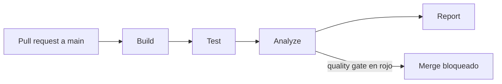

# Proyecto Final SQA: pipeline CI/CD con calidad integrada

[](https://github.com/Cristelm03/proyectoSqa/actions/workflows/ci.yml)
[](https://sonarcloud.io/summary/new_code?id=Cristelm03_proyectoSqa)
[](https://sonarcloud.io/summary/new_code?id=Cristelm03_proyectoSqa)
[](https://sonarcloud.io/summary/new_code?id=Cristelm03_proyectoSqa)
[](https://sonarcloud.io/summary/new_code?id=Cristelm03_proyectoSqa)
[](https://sonarcloud.io/summary/new_code?id=Cristelm03_proyectoSqa)
[](https://sonarcloud.io/summary/new_code?id=Cristelm03_proyectoSqa)

Proyecto final del curso de Aseguramiento de la Calidad de Software (SQA), 2026.

| | |
|---|---|
| **Autora** | Florecita Cristel Morales Lux |
| **Carnet** | 5190-21-9572 |
| **Modalidad** | Individual |

## De qué trata

Sobre una aplicación existente (CRUD de usuarios con login JWT, hecha con React, Express y MySQL) se construyó un pipeline de integración continua con la calidad integrada: análisis estático, pruebas automatizadas con cobertura mínima de 60 % y un *quality gate* de SonarQube Cloud que **impide fusionar a `main` el código que no cumple**.

La aplicación base es [arda-bahrul-ulum/express-reactjs](https://github.com/arda-bahrul-ulum/express-reactjs), con licencia MIT (ver [`LICENSE`](LICENSE)). El código original está marcado con el tag `baseline`, y todas las métricas de mejora se comparan contra él.

## Pipeline



| Etapa | Qué hace |
|---|---|
| **Build** | `npm ci`, ESLint y Prettier (backend y frontend) y compilación del frontend con Vite |
| **Test** | Jest + Supertest (backend) y Vitest + React Testing Library (frontend), con cobertura mínima de 60 % |
| **Analyze** | SonarQube Cloud con el quality gate "Sonar way"; si el gate falla, falla la etapa |
| **Report** | Resumen de pruebas y cobertura en la página de la ejecución |

La rama `main` está protegida con una ruleset: exige pull request y que pasen `Build`, `Test` y `Analyze`, y no permite force push ni borrado. Detalle en [`docs/Manual-Tecnico.md`](docs/Manual-Tecnico.md).

## Tecnologías

| Capa | Tecnología |
|---|---|
| Frontend | React 18, React Router 7, Axios, Vite 6 |
| Backend | Express 4, Prisma 5, bcrypt, jsonwebtoken, express-validator |
| Base de datos | MySQL 8 |
| Pruebas | Jest 29 + Supertest 7 (backend), Vitest 4 + React Testing Library (frontend) |
| Calidad | ESLint 9, Prettier 3, SonarQube Cloud |
| CI | GitHub Actions |

## Cómo ejecutarlo

Requisitos: Node.js 20 o superior, npm 10, MySQL 8 y Git.

**Backend** (`http://localhost:3000`)

```bash
cd backend-express
npm install
cp .env.example .env       # completa DATABASE_URL y JWT_SECRET
npx prisma migrate deploy  # crea la tabla users
npm start
```

**Frontend** (`http://localhost:5173`)

```bash
cd frontend-react
npm install
npm run dev
```

La base de datos debe existir antes (`CREATE DATABASE db_express;`). Las variables de entorno están descritas en [`backend-express/.env.example`](backend-express/.env.example).

### Scripts

| Comando | En | Qué hace |
|---|---|---|
| `npm test` | ambos | Ejecuta las pruebas |
| `npm run test:coverage` | ambos | Pruebas con cobertura (falla por debajo de 60 %) |
| `npm run lint` | ambos | ESLint |
| `npm run format:check` | ambos | Comprueba el formato con Prettier |
| `npm run build` | frontend | Compila para producción |

## Resultados

Comparación entre el código original (`baseline`) y `main`. La tabla completa, con la explicación de cada cambio, está en [`docs/Reporte-Mejora.md`](docs/Reporte-Mejora.md).

| Métrica | Antes | Ahora |
|---|---|---|
| Bugs (SonarQube) | 3 | 0 |
| Vulnerabilidades (SonarQube) | 2 | 0 |
| Code smells (SonarQube) | 12 | 0 |
| Deuda técnica (SonarQube) | 60 min | 0 min |
| Cobertura de pruebas (SonarQube) | 0 % | 99.5 % |
| Pruebas automatizadas | 0 | 123 |
| Duplicación (SonarQube) | 9.9 % | 3.7 % |
| Vulnerabilidades en dependencias de producción (`npm audit`) | 21 | 0 |

## Documentación

| Documento | Contenido |
|---|---|
| [`docs/SQA-Plan.md`](docs/SQA-Plan.md) | Plan de aseguramiento de calidad: alcance, responsabilidades, métricas y umbrales, herramientas, riesgos y cronograma |
| [`docs/Matriz-Pruebas.md`](docs/Matriz-Pruebas.md) | Casos de prueba unitarios, de integración y de regresión, y la comprobación de que detectan fallos |
| [`docs/Linea-Base-Calidad.md`](docs/Linea-Base-Calidad.md) | Métricas del código original, antes de intervenir |
| [`docs/Reporte-Mejora.md`](docs/Reporte-Mejora.md) | Comparación antes y después |
| [`docs/Manual-Tecnico.md`](docs/Manual-Tecnico.md) | Arquitectura, decisiones técnicas, guía de uso y mantenimiento |

## Licencia

MIT, la del proyecto original (ver [`LICENSE`](LICENSE)). El código de la aplicación base es de Arda Bahrul Ulum.
