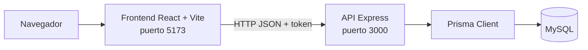
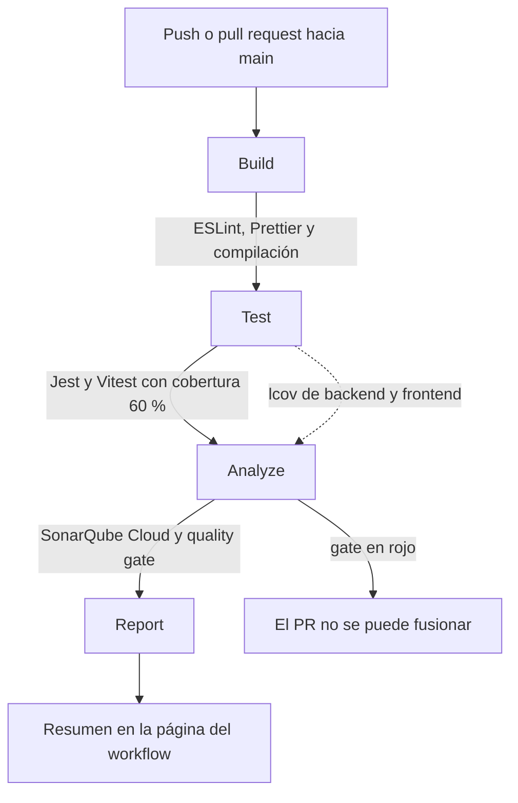

# Manual Técnico

Documento para quien deba entender, ejecutar o mantener el proyecto: arquitectura de la aplicación y del pipeline, decisiones técnicas, guía de uso y mantenimiento.

| | |
|---|---|
| **Autora** | Florecita Cristel Morales Lux, carnet 5190-21-9572 |
| **Repositorio** | https://github.com/Cristelm03/proyectoSqa |
| **Aplicación base** | [arda-bahrul-ulum/express-reactjs](https://github.com/arda-bahrul-ulum/express-reactjs) (licencia MIT) |

## 1. Arquitectura de la aplicación

La aplicación es un CRUD de usuarios con registro, login y rutas protegidas por JWT.



| Capa | Tecnología | Contenido |
|---|---|---|
| Frontend (`frontend-react`) | React 18, React Router 7, Axios, Vite 6 | Pantallas de inicio, registro, login, dashboard y CRUD de usuarios; el token JWT va en una cookie |
| Backend (`backend-express`) | Express 4, Prisma 5, bcrypt, jsonwebtoken, express-validator | Rutas `/api`, validación, autenticación y acceso a datos |
| Base de datos | MySQL 8 | Tabla `users` (definida en `prisma/schema.prisma`) |

**Estructura del backend**

```text
backend-express/
├── app.js                 # crea la aplicación Express (se exporta para las pruebas)
├── index.js               # arranca el servidor en el puerto de PORT o 3000
├── routes/                # definición de rutas /api
├── controllers/           # lógica de cada ruta (registro, login, usuarios)
├── middleware/auth.js     # verifica el JWT
├── utils/                 # validadores y utilidades (omitPassword, parseId)
├── prisma/                # esquema y migraciones
└── tests/                 # pruebas: unit, integration y regression
```

**Estructura del frontend**

```text
frontend-react/
├── src/
│   ├── components/        # SidebarMenu, UserForm, FormField
│   ├── context/           # AuthContext (estado de autenticación)
│   ├── routes/            # rutas públicas y protegidas
│   ├── services/api.js    # cliente Axios
│   └── views/             # pantallas: home, auth, admin
└── tests/                 # pruebas de Vitest y React Testing Library
```

## 2. Arquitectura del pipeline CI/CD



El archivo es `.github/workflows/ci.yml`. Se ejecuta en cada pull request hacia `main`, en cada push a `main` y de forma manual (`workflow_dispatch`). Las etapas dependen unas de otras (`needs`), así que si una falla las siguientes no se ejecutan, salvo `Report`, que siempre corre para dejar el resumen.

| Etapa | Pasos principales | Falla si |
|---|---|---|
| `Build` | `npm ci` en ambos paquetes; ESLint y Prettier del backend y del frontend; `vite build` | Hay errores de lint, formato o compilación |
| `Test` | `npm run test:coverage` del backend y del frontend; sube los reportes como artefactos | Una prueba falla o la cobertura baja de 60 % en cualquier métrica |
| `Analyze` | Descarga los dos `lcov.info`, les antepone la carpeta de cada paquete con `sed` y ejecuta el escáner de Sonar con `-Dsonar.qualitygate.wait=true` | El quality gate de Sonar no pasa |
| `Report` | Ejecuta `.github/scripts/ci-summary.js` y escribe el resultado en `$GITHUB_STEP_SUMMARY` | (nunca bloquea) |

### Protección de la rama principal

La ruleset **"Proteger main"** (Settings → Rules) está activa y sin lista de excepciones:

- Exige pull request antes de fusionar (0 aprobaciones, porque el proyecto es individual).
- Exige que pasen `Build`, `Test` y `Analyze`.
- Bloquea el force push y el borrado de la rama.

> En GitHub Free las reglas de rama no se aplican a repositorios privados. Por eso el repositorio es público.

## 3. Decisiones técnicas

| Decisión | Alternativa | Motivo |
|---|---|---|
| Separar `app.js` de `index.js` | Dejar `listen` al importar | Supertest necesita importar la aplicación sin abrir un puerto |
| Simular Prisma en las pruebas del backend | Usar MySQL real en el pipeline | Pruebas rápidas y sin infraestructura; a cambio no se verifica el SQL real (ver sección 7) |
| Vitest en el frontend | Jest | El proyecto ya usa Vite; Vitest comparte su configuración y sus transformaciones |
| Cobertura con V8 en Vitest | Istanbul | Sin instrumentación de código, y desde Vitest 4 solo cuenta líneas ejecutables |
| Pruebas en `frontend-react/tests`, fuera de `src` | Pruebas junto a cada archivo | Sonar solo analiza `src` como código de producción y las pruebas no cuentan como código nuevo |
| Escribir las pruebas del frontend antes de corregirlo | Corregir primero | El gate exige 80 % de cobertura en el código nuevo; tocar el frontend sin pruebas lo habría bloqueado |
| Acciones de GitHub fijadas por SHA de commit | Etiquetas como `@v4` | Una etiqueta se puede mover; el SHA es inmutable |
| `sed` sobre las rutas del `lcov` | Ejecutar las pruebas desde la raíz | Jest y Vitest escriben rutas relativas a cada paquete y Sonar las busca desde la raíz del repo |
| Quality gate "Sonar way" y esperar su resultado | No esperar el gate | Que la etapa `Analyze` falle es lo que bloquea el merge |
| `.prettierrc` único en la raíz con `endOfLine: "auto"` | Un archivo por paquete, fin de línea `lf` | En Windows los archivos usan CRLF y `lf` marcaba todo como mal formateado; `auto` funciona igual en Windows y Linux |
| `.catch` y `await` para las promesas | El operador `void` | Sonar marca `void` como mal uso (regla `S3735`) |
| Un formulario compartido (`UserForm`) | Dejar dos formularios copiados | Eliminó 41 líneas duplicadas que hacían fallar el gate de duplicación |
| El token JWT admite `Bearer <token>` y el token sin prefijo | Solo `Bearer` | El frontend original envía el token sin prefijo; así no se rompe |
| SonarQube Cloud, plan Free | Plan Team (de pago) | Cubre hasta 50 mil líneas privadas y proyectos públicos sin tarjeta |

## 4. Guía de uso

### Requisitos

- Node.js 20 o superior y npm 10.
- MySQL 8.
- Git.

### Backend

```bash
cd backend-express
npm install
cp .env.example .env      # completa DATABASE_URL y JWT_SECRET
npx prisma migrate deploy # crea la tabla users en la base indicada
npm start                 # http://localhost:3000
```

`JWT_SECRET` se genera con `node -e "console.log(require('crypto').randomBytes(32).toString('hex'))"`. La base de datos debe existir antes (`CREATE DATABASE db_express;`). Como alternativa a las migraciones se puede importar el volcado `dump-db_express-202411060944.sql`.

Variables de entorno (`.env.example`):

| Variable | Obligatoria | Descripción |
|---|---|---|
| `DATABASE_URL` | Sí | Cadena de conexión de MySQL |
| `JWT_SECRET` | Sí | Secreto para firmar los tokens |
| `PORT` | No | Puerto de la API (por defecto 3000) |
| `CORS_ORIGIN` | No | Orígenes permitidos, separados por coma (por defecto `http://localhost:5173`) |

### Frontend

```bash
cd frontend-react
npm install
npm run dev               # http://localhost:5173
```

El cliente apunta a `http://localhost:3000` (`src/services/api.js`).

### Scripts disponibles

| Comando | En | Qué hace |
|---|---|---|
| `npm test` | ambos | Ejecuta las pruebas |
| `npm run test:coverage` | ambos | Ejecuta las pruebas con cobertura y exige el umbral de 60 % |
| `npm run lint` / `lint:fix` | ambos | ESLint (con o sin corrección automática) |
| `npm run format` / `format:check` | ambos | Prettier (aplica o solo comprueba) |
| `npm run build` | frontend | Compila para producción |
| `npm start` | backend | Arranca la API |

## 5. Guía de mantenimiento

### Añadir una prueba

1. Crea o amplía un archivo `*.test.js` (backend) o `*.test.jsx` (frontend) dentro de `tests/`.
2. Empieza el nombre con un identificador nuevo, por ejemplo `TC-I29: ...`. Los prefijos son `TC-U` (unitarias), `TC-I` (integración), `TC-R` (regresión) y `TC-F` (frontend).
3. Añade una fila a `docs/Matriz-Pruebas.md`.
4. Si la prueba cubre un defecto, comprueba antes que **falla** con el código sin corregir.

### Cambiar un umbral

- Cobertura: `backend-express/jest.config.js` (`coverageThreshold`) y `frontend-react/vitest.config.js` (`coverage.thresholds`).
- Quality gate de Sonar: en SonarQube Cloud, *Quality Gates*. Si cambia, actualiza la sección 6 de `SQA-Plan.md`.

### Actualizar una acción de GitHub

1. Busca el SHA de la nueva etiqueta con la API: `https://api.github.com/repos/<owner>/<repo>/git/ref/tags/<etiqueta>` (si el objeto es un `tag`, sigue su `url` para obtener el commit).
2. Reemplaza el SHA en `ci.yml` y deja la versión en el comentario.

### Rotar el token de Sonar

Genera uno nuevo en SonarQube Cloud (*My Account → Security*), actualiza el secreto `SONAR_TOKEN` en *Settings → Secrets and variables → Actions* y revoca el anterior. El token nunca se escribe en el repositorio.

### Revisar dependencias

Al cerrar cada fase se ejecuta `npm audit` y `npm audit --omit=dev` en ambos paquetes. En producción no debe haber vulnerabilidades críticas ni altas.

### Reproducir la línea base

```bash
git checkout baseline          # código original, sin ninguna intervención
```

Las medidas de Sonar de ese estado están en el análisis de la revisión `0fae5ed` y, junto con las demás, en `Linea-Base-Calidad.md`.

## 6. Problemas encontrados y cómo se resolvieron

| Síntoma | Causa | Solución |
|---|---|---|
| El quality gate pasó con 0 % de cobertura en la línea base | "Sonar way" solo evalúa el código nuevo, y el primer análisis no tiene con qué comparar | Imponer los umbrales también en Jest y Vitest, que sí fallan el pipeline |
| Sonar no veía la cobertura | Las rutas del `lcov` eran relativas a cada paquete | `sed` que antepone `backend-express/` y `frontend-react/` |
| Líneas de código infladas (de 1 160 a 1 709) y gate en rojo | Sonar trataba las pruebas como código de producción | `sonar.tests`, `sonar.test.inclusions` y `sonar.exclusions` |
| El gate falló por la cobertura del código nuevo | Un archivo de configuración sin pruebas contaba como código nuevo | Excluirlo del análisis, igual que ya se hacía en Jest |
| El gate falló por 12.8 % de duplicación en un PR del frontend | `create.jsx` y `edit.jsx` repetían 41 líneas y el PR las modificó | Extraer `UserForm` y `FormField` |
| Prettier marcaba todos los archivos en Windows | Saltos de línea CRLF frente a `endOfLine: "lf"` | `endOfLine: "auto"` |
| La versión por defecto de `jsdom` (27) declaraba un Node más nuevo que el del entorno | `jsdom` 27 exige Node 20.19 o superior y el entorno local tenía 20.18 | Fijar `jsdom` 25 antes de ejecutar las pruebas (decisión preventiva, no un fallo observado) |
| Una mutación de prueba colgó Vitest con más de 1 GB de memoria | Al invertir una guarda de ruta se produjo un bucle infinito de redirecciones | Terminar el árbol de procesos y repetir con una mutación sin bucle y con límite de tiempo |
| `npm audit` empeoró al añadir herramientas | Las dependencias de desarrollo traen vulnerabilidades transitivas | `npm audit fix`, `bcrypt` 6, `react-router-dom` 7, y Vite 6 con Vitest 4 |

## 7. Limitaciones conocidas

- Las pruebas del backend simulan Prisma: verifican rutas, validaciones, autenticación y contratos HTTP, pero no el SQL real ni las restricciones de MySQL.
- Queda una duplicación de 3.7 % (59 líneas) entre `register` y `createUser` en el backend; está aceptada como deuda técnica (`SQA-Plan.md`, sección 9).
- No hay pruebas end-to-end con navegador real ni de rendimiento (fuera del alcance del enunciado).
- El quality gate usa la definición por defecto de SonarQube Cloud; el plan Free puede limitar su personalización.
- Las acciones oficiales de GitHub declaran Node 20, en desuso, y generan advertencias que no bloquean.
- Quedan avisos moderados y bajos de `npm audit` en herramientas de desarrollo (ESLint y Jest): 25 en el backend y 6 en el frontend, ninguno crítico ni alto, y ninguno en producción.
